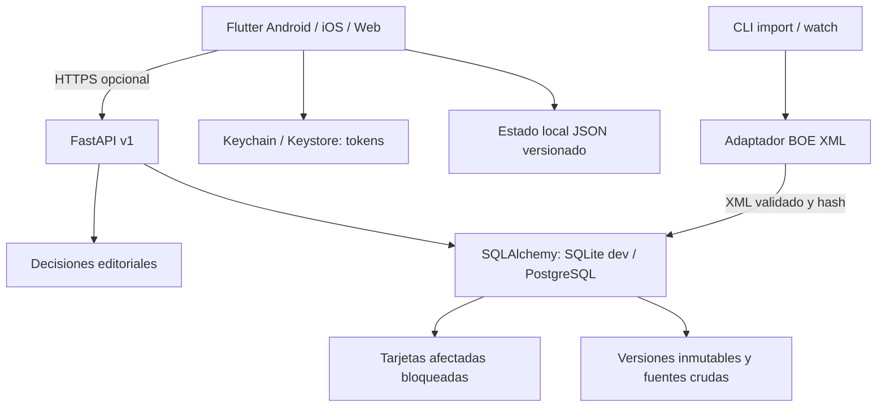

# Arquitectura implementada y límites

## Invariantes

- Las versiones importadas tienen SHA-256 del XML recibido y conservan estructura original. Una importación fallida se pone en cuarentena; no sustituye la última válida. Los bloques se identifican por el ancla externa BOE.
- Las tarjetas afectadas se bloquean conservadoramente por norma en una misma transacción que incorpora la nueva versión. No se infiere derogación tácita. El cliente invalida el pack desactualizado al recibir metadatos nuevos, archiva el anterior y bloquea tarjetas enlazadas sin borrar revisiones.
- Publicación editorial requiere dos actores distintos del autor. La ruta está deshabilitada por defecto. Falta verificar una pasarela MFA real y firmar auditoría antes de habilitarla en producción.
- Los eventos de revisión se insertan con clave única por usuario. Repetir el mismo evento devuelve el mismo resultado; reutilizar la clave con otro contenido devuelve 409. Los estados se programan en servidor, sin aceptar estabilidad/intervalos inventados por el cliente.
- Subidas de mazos y tarjetas usan IDs estables por usuario y dispositivo. Reintentar no duplica; cambiar contenido con el mismo ID requiere resolver el conflicto. Los secretos de sesión se guardan aparte, nunca en exportaciones.
- El cliente no elimina una revisión local al fallar la red. Marca cada revisión solo después de confirmación. La sincronización permite subida y descarga de tarjetas, historial y estados; conserva explícitamente conflictos de contenido y revisiones locales pendientes. No fusiona notas o planes ni resuelve automáticamente ediciones divergentes.
- Un intento de examen guarda sus preguntas/revisiones y penalización antes de responder. El servidor oculta soluciones hasta entregar. La app local conserva las soluciones porque debe corregir sin conexión: no es un entorno de examen supervisado.
- No hay cobros reales. La promoción de servidor dura 30 días y nunca se transforma en suscripción. El endpoint de pagos devuelve 503 hasta integrar validación oficial.

## Almacenamiento

`records` contiene agregados de norma, versión, tarjeta, mazo, intento, perfil, nota y revisión; `accounts`, `tokens`, `mutations` y `audit` separan identidad, autenticación, deduplicación y decisiones. Es una implementación inicial, distinta del esquema normalizado objetivo del documento.

En Android/iOS los datos educativos se guardan como un snapshot transaccional JSON dentro de SQLCipher, con clave independiente en Keychain/Keystore y migración que comprueba la escritura antes de retirar el original. Web conserva preferencias JSON sin este cifrado. La integración nativa está pendiente de ejecución. Queda normalizar tablas y consultas para corpus grandes. No se afirma que `SharedPreferences` garantice recuperación tras cualquier fallo físico. El código no imprime tokens ni respuestas privadas.

## Fechas

Instantes de API en UTC; el cron CLI obtiene su fecha civil en `Europe/Madrid`. La lectura conserva fechas de publicación y efecto separadas según BOE, y selecciona la redacción por fecha efectiva explícita cuando los metadatos lo permiten; rechaza fechas incompletas, intervalos contradictorios y textos en conflicto. No calcula derecho aplicable en casos ambiguos ni vigencias parciales. Los vencimientos móviles se guardan UTC y se agrupan en calendario local para estadísticas.

## Servicios aún no conectados

PostgreSQL administrado, OAuth/email, MFA, colas, almacenamiento de objetos, notificaciones FCM/APNs, Play Billing/StoreKit, email, observabilidad y backup cifrado. El repositorio no contiene credenciales de estos servicios ni finge su respuesta.
